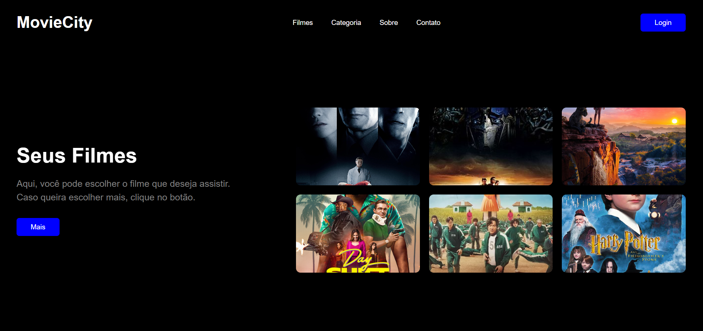

# MovieCity - Landing Page

O **MovieCity** é uma aplicação web interativa e responsiva desenvolvida em React para apresentação de catálogo de filmes[cite: 2, 5]. O projeto apresenta um layout moderno com tema escuro, navegação simplificada e visualização em grelha.



---

## Tecnologias Utilizadas

Este projeto foi construído com as seguintes tecnologias:

- **[React](https://react.dev/)** - Biblioteca JavaScript para construção de interfaces[cite: 2, 5, 7]
- **[Vite](https://vitejs.dev/)** - Ferramenta de build e servidor de desenvolvimento rápido[cite: 4, 8]
- **CSS3** - Estilização customizada com CSS Grid, Flexbox e Media Queries para responsividade[cite: 3]

---

## 📁 Estrutura do Projeto

```text
01_landinpage/
├── src/
│   ├── components/
│   │   ├── Header.jsx    # Cabeçalho com navegação e menu responsivo
│   │   ├── Home.jsx      # Componente principal que junta Header e Main
│   │   └── Main.jsx      # Secção de destaque e grelha de cartões
│   ├── App.jsx           # Componente raiz da aplicação
│   ├── index.css         # Estilos globais e componentes da página
│   └── main.jsx          # Ponto de entrada do React
├── index.html            # Estrutura HTML base
└── package.json          # Dependências do projeto
```
